<div align="center">


# Versify

**A quieter way to listen, and a closer way to follow every word.**


<br>
<br>



<sub>[Get started](#get-started) &nbsp;·&nbsp; [How it works](#how-a-song-finds-its-words) &nbsp;·&nbsp; [Liner notes](#liner-notes)</sub>

</div>

<br>

Versify is a listening room where lyrics take center stage. Find a song, settle into its artwork, and let each line meet the music, right on time. No feed, no recommendations wall: just one song, its sleeve, and its words.

> [!NOTE]
> There are no accounts. Favorites, playlists, and settings stay in the browser you use, and do not sync between devices.

## Side A

| No. | Track | Liner note |
|:---:|---|---|
| 01 | **Find the song you mean** | Search Apple's catalog, including artists only sold in Japan, and pick the exact recording. |
| 02 | **Follow every word** | Timed lyrics glow and scroll with playback. Tap a line to jump there, or scroll back and read at your own pace. |
| 03 | **Hear the right version** | Versify plays the official master the lyrics were timed to. Wrong edit? Connect any YouTube link and nudge the timing. |
| 04 | **Read it in your language** | Optional translations sit beneath each line: Korean, Japanese, Chinese, French, Spanish, or Portuguese. |
| 05 | **Keep a small library** | Save favorites, build and rename playlists, shuffle and loop them. Everything stays in this browser, with no account. |
| 06 | **Let the artwork set the room** | The palette is drawn from the sleeve. Choose the lyric size and a 12- or 24-hour clock, then go fullscreen. |
| 07 | **Never run out** | When a song ends, the next one comes from the same genre and its charts. |

## How a song finds its words

<picture>
  <source media="(prefers-color-scheme: dark)" srcset="docs/readme/flow-dark.svg">
  
</picture>

Synchronized lyrics only work when the words and the audio describe the *same recording*. Versify holds every step to that:

1. **Search.** Apple's catalog provides the title, artist, album, and exact length. When the US store translates a name (*If there was practice in love*), Versify also looks up the original (*사랑에 연습이 있었다면*).
2. **Words.** LRCLIB supplies timed lyrics. Credits and remaster labels can differ, but the length must agree within three seconds, or the lyrics are shown untimed rather than out of step.
3. **Recording.** YouTube Music's official song uploads are the label's master, the same one the lyrics were timed against. Covers, karaoke, live, and sped-up versions are left out.
4. **In sync.** Each line lands on its moment.

> [!TIP]
> If a song still drifts, choose **Change source**, paste another YouTube recording, and set **Lyric timing** in half-second steps until the words land.

## 의도 · The intention

> **Versify의 의도는 음악을 단순히 재생하는 것을 넘어, 가사와 멜로디가 만나는 순간에 더 가까이 머무는 경험을 만드는 것입니다.** 화면을 복잡한 추천이나 피드로 채우기보다, 앨범 아트와 동기화된 가사를 중심에 두어 한 곡을 천천히 듣고 읽을 수 있도록 만들었습니다.
>
> *Versify is meant to bring the listener closer to the moment where lyrics meet melody. Instead of filling the screen with feeds and recommendations, it keeps artwork and synchronized words in focus, making space to listen to one song and to really read it.*

## Get started

Requires **Node.js 22.18** or newer and an internet connection.

```sh
npm install
npm run dev
```

Open [localhost:3000](http://localhost:3000). Search, lyrics, and audio matching work without any keys. Two optional services can be added in `.env.local` (the names are listed in `.env.example`):

| Variable | Adds |
|---|---|
| `GOOGLE_TRANSLATE_API_KEY` | On-demand lyric translation, using a server-side key with Cloud Translation enabled. |
| `YOUTUBE_API_KEY` | An extra fallback for audio matching, using a server-side key with YouTube Data API v3 enabled. |

Restart the dev server after changing these, and set production values in your hosting provider.

> [!CAUTION]
> Both keys are server-side secrets tied to your Google Cloud project, where misuse can exhaust quota or run up charges. Never commit `.env.local` or paste real keys into client code.

## Liner notes

Versify brings together independent services; it does not host or distribute music.

- **Search:** Apple's public iTunes Search API, across the US and Japanese storefronts.
- **Lyrics:** [LRCLIB](https://lrclib.net). Synchronized lyrics are shown when they match the recording; untimed text is never presented as timed.
- **Audio:** YouTube's embedded player, preferring official YouTube Music recordings. Availability depends on region and embed permissions, and you can always connect another recording.
- **Translation:** Optional Google Cloud Translation. Machine translation may miss a lyric's nuance.
- **Library:** Favorites, playlists, and preferences live in this browser's storage, with no accounts or sync.

> [!IMPORTANT]
> Versify is not a licensed streaming service. These services and their content can change, so check each provider's terms, and the rights involved, before any public or commercial deployment.

## For contributors

```sh
npm test            # unit tests
npm run typecheck   # TypeScript
npm run build       # production build
```

Built with Next.js, React, and TypeScript. The README artwork in `docs/readme/` is plain animated SVG, generated by `node docs/readme/generate.mjs`.

> [!WARNING]
> Audio matching first queries YouTube Music's public web search, which is not an official API and can change without notice. If it stops responding, Versify falls back to YouTube search, so keep that path working when you change `lib/video-match.ts`.

<br>

<div align="center"><sub>Made for listening · © 2026 Jamie Ryu</sub></div>
