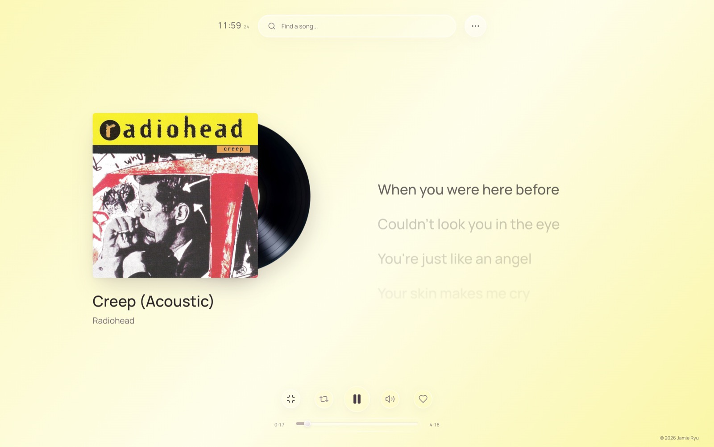
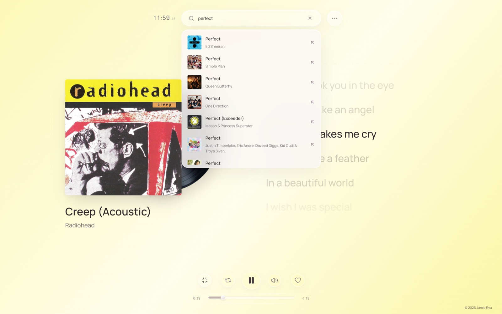
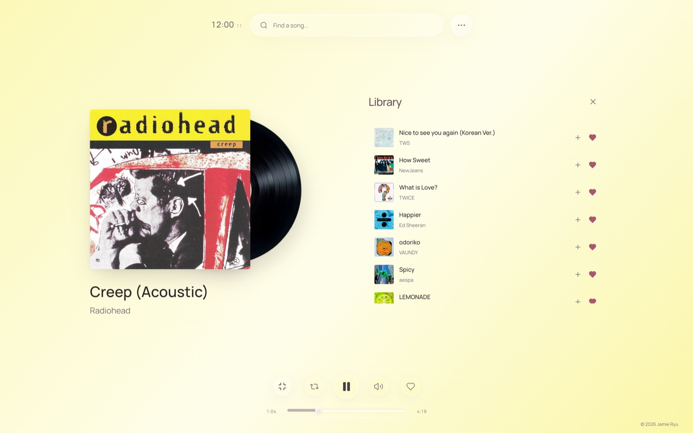
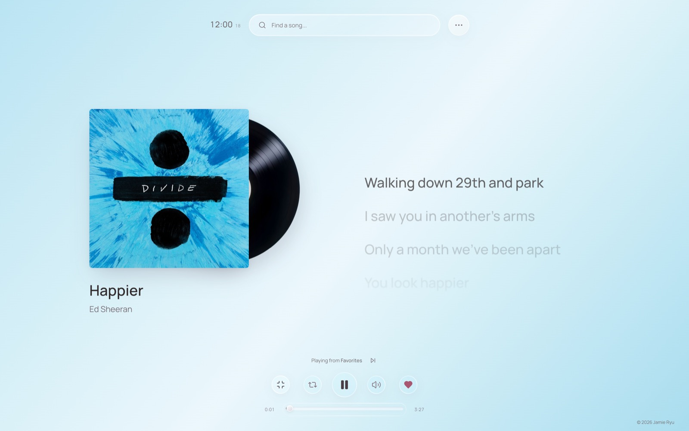
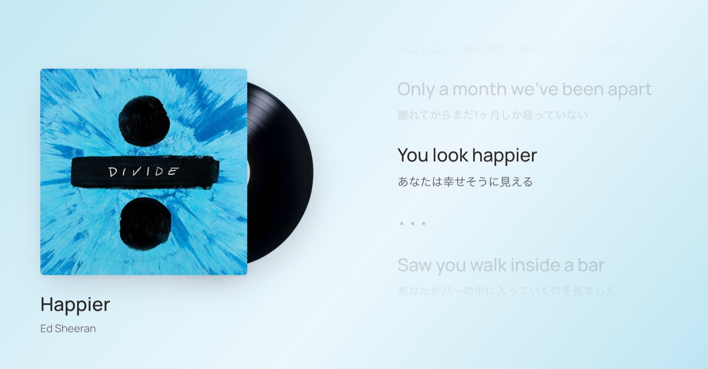

<div align="center">

# Versify

### A quieter way to listen—and a closer way to follow every word.

A music listening room where synchronized lyrics take center stage. Find a song, settle into its artwork, and let each line meet the music in real time.

[Get started](#get-started) · [Explore the features](#made-for-listening) · [Why Versify](#why-versify)

</div>

---

## A listening room, not another feed

Versify pairs a pared-back record-inspired player with live song discovery and synchronized lyrics. The artwork sets the color and mood; the lyrics stay in step with playback, ready to follow, seek, or translate.

<div align="center">



<sub>The current song, its sleeve, a record in motion, and lyrics that follow the music.</sub>

</div>

## Made for listening

- **Find a song.** Search a broad, changing pool of songs from the Apple catalog and pick the recording you mean from the results.
- **Follow the lyrics.** Timed lyrics highlight and scroll with playback. Choose a line to seek to that moment, or pause and read at your own pace.
- **Listen to a version that fits.** Versify looks for a matching YouTube recording. If it finds the wrong version—or no match—you can connect a YouTube link yourself and adjust lyric timing.
- **Build a little library.** Save favorites, make and rename playlists, shuffle a collection, and pick up where you left off. Your library stays in this browser; there is no account or cloud sync.
- **Make it yours.** Artwork colors the listening room. Tune lyric size and language, choose a 12- or 24-hour clock, and move into fullscreen.
- **Keep the essentials close.** Play or pause, seek, adjust volume, repeat a song or playlist, and jump to the next track from a compact set of controls.

<div align="center">

| Search | Library |
|:---:|:---:|
|  |  |
| Find the right song from a title search. | Keep favorites and playlists together. |

</div>

<div align="center">

| A room shaped by the artwork | Lyrics in another language |
|:---:|:---:|
|  |  |
| The palette changes with the record. | Optional lyric translation keeps the song in view. |

</div>

## Why Versify

Most large music services are built around expansive catalogs, recommendations, and playlists. Versify takes a smaller, more focused approach: **the lyrics are part of the listening experience, not an afterthought**. The interface gives the song room to breathe, and makes the connection between a lyric and its exact moment in the recording something you can see, hear, and explore.

It is also intentionally flexible about the recording. Rather than pretending every search result has one definitive version, Versify lets you bring a YouTube link when its suggested audio does not fit the lyrics. Favorites and playlists are lightweight browser-based collections, not a new social or account system.

That focus comes with a trade-off: Versify is **not** a licensed, all-in-one streaming catalog. Search results, lyric availability, translations, and playback depend on third-party services, network access, region, and video embed permissions. Read [the details](#a-note-on-music-and-services) before deploying it publicly.

## 의도 · The intention

**Versify의 의도는 음악을 단순히 재생하는 것을 넘어, 가사와 멜로디가 만나는 순간에 더 가까이 머무는 경험을 만드는 것입니다.** 화면을 복잡한 추천이나 피드로 채우기보다, 앨범 아트와 동기화된 가사를 중심에 두어 한 곡을 천천히 듣고 읽을 수 있도록 만들었습니다.

*Versify is meant to bring the listener closer to the moment where lyrics meet melody. Instead of filling the screen with feeds and recommendations, it keeps artwork and synchronized words in focus—making space to listen to one song, and to really read it.*

## Get started

**Requirements:** Node.js 22.18 or newer and an internet connection.

```sh
npm install
npm run dev
```

Open [http://localhost:3000](http://localhost:3000).

The app works without API keys for its built-in featured tracks. To enable the optional services, copy the variable names from `.env.example` into `.env.local` and supply your own keys:

| Variable | Enables | Notes |
|---|---|---|
| `YOUTUBE_API_KEY` | Automatic audio matching for other songs | A server-side key with YouTube Data API v3 enabled. Without it, use **Connect audio** to provide a YouTube link. |
| `GOOGLE_TRANSLATE_API_KEY` | On-demand lyric translation | A server-side key with Google Cloud Translation enabled. |

Restart the development server after changing environment variables. Keep real keys private; do not commit `.env.local`. Configure production environment variables in your hosting provider.

## A note on music and services

Versify brings together several independent sources; it does not host or distribute music.

- **Song search:** Apple’s public iTunes Search API.
- **Lyrics:** LRCLIB. Synchronized lyrics are shown when available; unsynchronized text is not presented as if it were timed.
- **Audio:** YouTube playback through its embedded player. Matching can choose a different edit or master, and availability depends on region, embed permissions, and the browser. You can connect another YouTube recording if needed.
- **Translation:** Optional Google Cloud Translation. Translations are machine-generated and may not capture a lyric’s full nuance.
- **Personal library:** Favorites, playlists, and preferences are saved in browser storage on this device. There are no user accounts or cross-device sync.

Availability of these services and their content may change. Check the relevant provider terms and rights before public or commercial use.

## For contributors

```sh
npm test
npm run typecheck
npm run build
```

Built with Next.js, React, TypeScript, and Tailwind CSS. See the project files for the app structure, API routes, and individual UI components.
